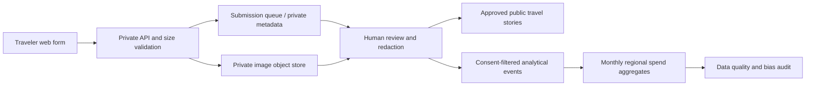

# Big Data design extension: traveler-contributed itineraries

## Concrete analytical question

Can voluntary, source-identified traveler expense records eventually improve the descriptive cost coverage of destinations without treating individual stories as representative tourist statistics?

## Entity and event model

`Trip` (UUID, month YYYY-MM, party size, stops, publication status, disclosure/consent flags) has many `Stop` records (municipality/attraction id, ordinal) and many `Expense` records (stop id, category, MXN paid by group, optional provider label). `MediaObject` is stored **outside the relational DB** (object storage key, checksum, pixel dimensions, MIME, approval state). Raw submissions remain **private**; a reviewed, redacted projection is copied into the public gallery.

### Separation of purpose

- **Tourism supply**: authoritative municipality–activity source records in the canonical SQLite knowledge base.
- **Supplier quotes**: dated provider offers, currency/unit/validity, reviewed independently.
- **Traveler observations**: consent-based, self-reported transactions; not live quotes and not automatically representative.
- **Synthetic test rows**: generated workload used only for performance validation.

## Pipeline

The included local pilot covers A–F in part: A and review publication work, a B/C pilot exists, and D is a local filesystem surrogate for object storage. G–I remain an architecture and methodological proposal, not a deployed multi-tenant data lake.

## Scale strategy, when volume justifies it

Use API validation and a queue for bursts; object storage (R2/S3-compatible) for media; a relational metadata store (Postgres/D1) for normalized records; write immutable review/audit events; partition event tables by month; deliver periodic columnar Parquet exports and query aggregates with DuckDB/Spark only if actual volume warrants it. Separate identifiers and delete request paths. Maintain per-source provenance and an approval timestamp.

## Evaluation protocol

- Test schema rejection: invalid month, expense amount, stop ids, media MIME, oversize and duplicates.
- Confirm unapproved submissions never appear in public JSON or image paths.
- Measure ingress throughput, data validation failures, storage growth, queue lag, approved-publication latency and query time.
- Compare unindexed versus indexed grouping using *synthetic* expenditure rows (see `tools/benchmark_trips.py`) and report the row counts as generated, not observed data.
- Only after a sufficiently sized voluntary collection, report distributions with explicit sample size, date, geography, missing-cost rates, consent counts and selection bias. Do not estimate actual tourism demand or representative local prices from route-sharing uptake alone.

## Academic positioning

This offers a sensible extension of the storage course: heterogeneous structured traveler data, semi-structured stories, binary media objects, moderation/quality controls, provenance, scalable storage design and a testable processing benchmark. It supplements the already-completed DataTur scale benchmark. It is **not** a substitute for evidence that distributed processing was actually implemented or needed.
